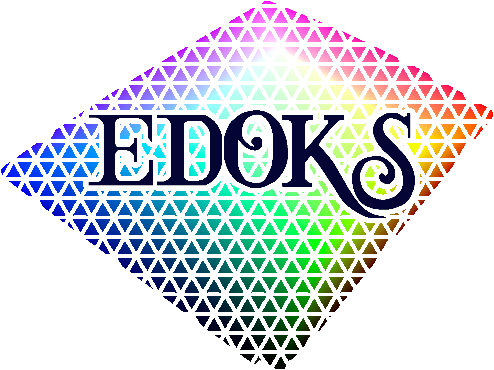
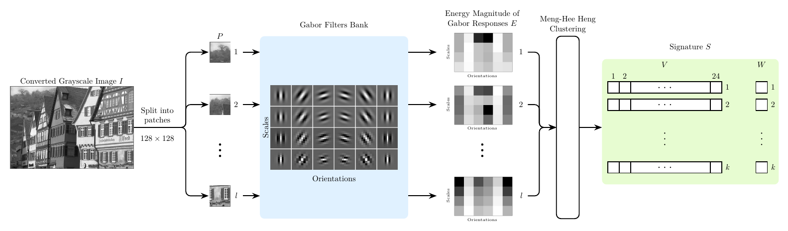
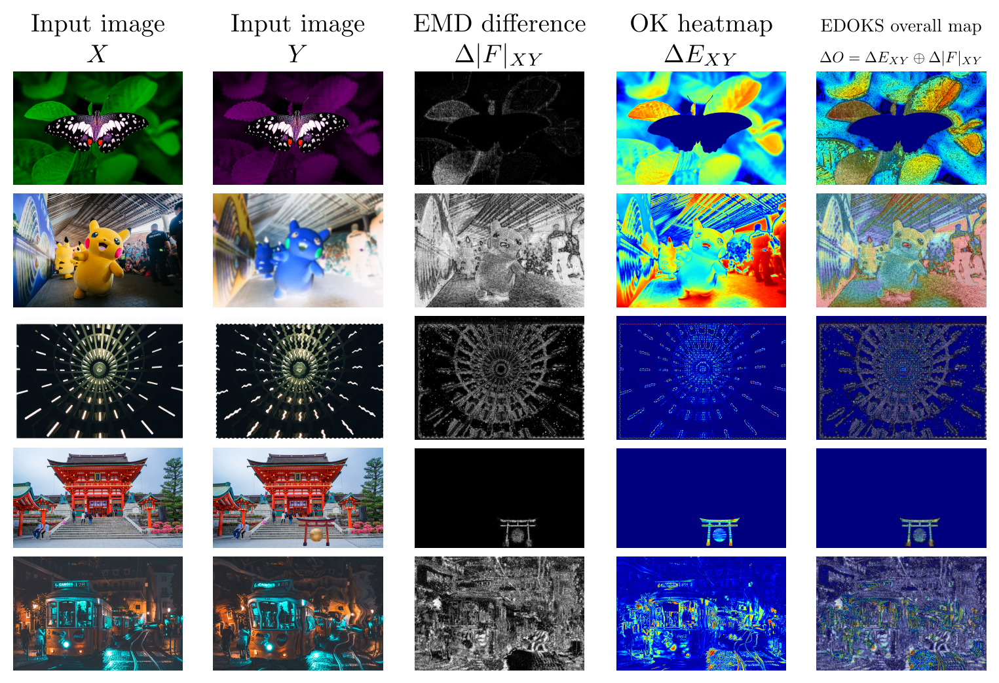
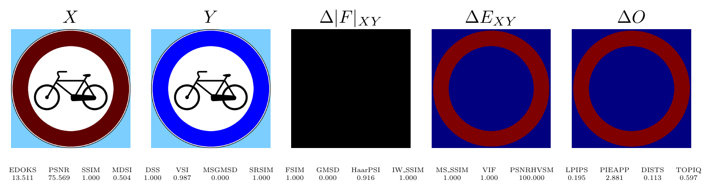

<div align="center">

[](LICENSE)
[](https://www.python.org/downloads/release/python-380/)
[](https://opencv.org/)
[](https://numpy.org/)
[](https://scikit-image.org/)
[](https://scipy.org/)
[](https://cmake.org/)
[](https://gcc.gnu.org/)



# EDOKS
### Earth mover's Distance and Oklab Similarity

**A white-box, full-reference image similarity metric for perceptual and transparent geometric and chromatic assessment**

Official implementation of the paper
*"A new Image Similarity Metric for a Perceptual and Transparent Geometric and Chromatic Assessment"*

[Paper](https://link.springer.com/article/10.1007/s44163-026-02424-4) · [Citation](#citation) · [Usage](#usage) · [Results](#results)

</div>

---

## Overview

Classic full-reference IQA metrics such as **PSNR** and **SSIM** often disagree with human judgments on texture and shape distortions. Deep perceptual metrics such as **LPIPS** close much of that gap, but their scores are opaque: you cannot tell *which* part of the image, or *which* kind of difference, drove the result.

**EDOKS** sits in between. It has **no learned parameters**, needs **no GPU and no training**, and splits perceptual dissimilarity into two interpretable terms:

| Term | What it measures | How |
|---|---|---|
| **EMD** (texture / geometry) | Differences in shape and texture | Earth Mover's Distance between Gabor-energy signatures of grayscale patches |
| **OK** (colour) | Perceived colour differences | Pixel-wise Euclidean distance (ΔE) in the Oklab perceptual colour space |

Besides the scalar score, EDOKS returns **pixel-level heatmaps** for each term, so you can see where the two images differ and whether the difference is in texture, in colour, or both.

<!-- Add the pipeline figure (Fig. 2 of the paper) as images/pipeline.png -->
<p align="center">
  
</p>

## Key features

- **Perceptually aligned.** Best correlation with human judgments among the tested low-level FR metrics on BAPPS (JND and 2AFC), approaching deep metrics.
- **Transparent.** Separate texture and colour evidence maps explain every score.
- **Colour-aware.** Catches colour changes that luminance-only metrics miss entirely (for example, two colours mapped to the same gray level by ITU-R BT.601).
- **Geometry-aware.** Sensitive to warping, blur and other structural distortions through Gabor signatures.
- **Decomposable.** The texture (EMD) and colour (OK) scores are returned alongside EDOKS, so you can see which component drives the result.

## How it works

### 1. Texture term (EMD)

1. Convert the image to grayscale and split it into non-overlapping `p × p` patches (default `p = 128`).
2. Filter each patch with a Gabor bank of **4 scales** `{0.1, 0.2, 0.3, 0.4}` × **6 orientations** `{0°, 30°, …, 150°}` = 24 filters.
3. Compute the energy of each response magnitude and normalise per patch, giving a 24-dimensional vector per patch.
4. Cluster the patch vectors with the **Meng-Hee Heng** max–min algorithm (the number of clusters `k` is chosen automatically) to obtain a signature `S = (V, W)` of centroids and weights.
5. Compare the two signatures with the **Earth Mover's Distance** (L1 ground distance).

### 2. Colour term (OK)

Both images are converted to **Oklab**, and the mean per-pixel Euclidean distance is computed:

$$
OK(\hat X,\hat Y) = \frac{1}{MN}\sum_{i=1}^{M}\sum_{j=1}^{N}\Delta E(\hat X_{i,j},\hat Y_{i,j}),
\qquad
\Delta E = \sqrt{\Delta L^2 + \Delta a^2 + \Delta b^2}
$$

Oklab is used instead of CIE Lab because it is more uniform in hue (notably in the blue region), numerically simple and invertible in closed form.

### 3. EDOKS index

The two dissimilarity terms are combined convexly and turned into a similarity score:

$$
EDOK(X,Y) = \alpha\,EMD(S_X,S_Y) + (1-\alpha)\,OK(\hat X,\hat Y)
\qquad
EDOKS(X,Y) = \frac{1}{EDOK(X,Y) + c}
$$

- `α ∈ [0, 1]` balances texture vs. colour. The released code uses `α = 0.5` (equal weight), as in all experiments of the paper.
- `c` is a tiny constant (the smallest positive normalised float) that avoids division by zero for identical images.

**Higher EDOKS means more similar.** We recommend reporting the EMD and OK terms alongside EDOKS to see which component drives the score.

## Installation

**Requirements:** Python ≥ 3.7 (tested on 3.8 and 3.10), `numpy`, `opencv-python`, `scikit-image`, `scipy`.
The Earth Mover's Distance is computed by a C implementation (`edoks/emd_c`), built with CMake and a C compiler.

```bash
git clone https://github.com/antdimarino/EDOKS.git
cd EDOKS
pip install .
```

> **Note:** the repository ships a precompiled `libemd.so` for Linux. On other platforms, build the library from `edoks/emd_c` with CMake:
>
> ```bash
> cd edoks/emd_c
> cmake -S . -B build -DCMAKE_BUILD_TYPE=Release
> cmake --build build
> ```

## Usage

Images are read with OpenCV and passed as BGR arrays.

### Compare two images

```python
import cv2
from edoks import EDOKS

img1 = cv2.imread("reference.png")
img2 = cv2.imread("distorted.png")

metric = EDOKS()  # defaults: freq=[0.1, 0.2, 0.3, 0.4], n_or=6, p_size=128

edoks_score, emd_score, ok_score = metric.compute_two_img(img1, img2)

print(f"EDOKS (similarity):      {edoks_score:.3f}")
print(f"EMD   (texture distance): {emd_score:.3f}")
print(f"OK    (colour distance):  {ok_score:.3f}")
```

Both `compute_two_img` and `compute_one_img` return the tuple `(EDOKS, EMD, OK)`. After a call, the scores are also available as attributes: `metric.edoks_score`, `metric.edok_score`, `metric.emd_score`, `metric.ok_score`.

### Save the explainability maps

Pass `path_save` (and optionally a `name`) to save the three heatmaps:

```python
import os

os.makedirs("maps", exist_ok=True)
metric.compute_two_img(img1, img2, name="example", path_save="maps")
```

This writes:

| File | Content |
|---|---|
| `EMD_example_heatmap.png` | Texture / geometry difference **Δ\|F\|** (Gabor magnitude difference) |
| `OK_example_heatmap.png` | Colour difference **ΔE** in Oklab (JET colormap) |
| `EDOKS_example_heatmap.png` | Overlay **ΔO** of the two maps |

Use `path_save=""` to save in the current directory. With the default `path_save=None` no maps are written. Existing files with the same name are overwritten (a warning is raised), so give each comparison a different `name`; any file extension in `name` is stripped.

### Compare one reference against many images

When the same reference is compared with several images, set it once with `set_img1`: its texture signature and Oklab conversion are computed only once.

```python
import cv2
from edoks import EDOKS

metric = EDOKS()
metric.set_img1(cv2.imread("reference.png"))

scores = {}
for path in ["dist_01.png", "dist_02.png", "dist_03.png"]:
    edoks_score, emd_score, ok_score = metric.compute_one_img(cv2.imread(path))
    scores[path] = edoks_score
```

### Using the two terms separately

The texture and colour terms are also available as standalone classes:

```python
from edoks import EMD, Oklab

emd_score = EMD(frequencies=[0.1, 0.2, 0.3, 0.4], num_orientations=6, patch_size=128).compute_two_img(img1, img2)
ok_score  = Oklab().compute_two_img(img1, img2)
```

### Parameters

| Parameter | Default | Description |
|---|---|---|
| `freq` | `[0.1, 0.2, 0.3, 0.4]` | Gabor filter scales (spatial frequencies), from fine to coarse texture. |
| `n_or` | `6` | Number of Gabor orientations, evenly spaced over [0°, 180°) (6 → 30° step). |
| `p_size` | `128` | Patch side `p` for the texture signature. Scale it with image resolution to keep the number of patches roughly constant: smaller patches increase runtime steeply (clustering is `O(l³)`). |

The current implementation combines the two terms with equal weight (`α = 0.5`), the default used for all results in the paper.

## Results

All experiments use the validation split of **BAPPS** (Zhang et al., 2018), which includes traditional, CNN-generated and geometric distortions. Default settings: `p = 128`, `α = 0.5`.

### Correlation with human judgments (JND)

| Metric | SROCC ↑ | KROCC ↑ | PLCC ↑ |
|---|---|---|---|
| **EDOKS** | **0.537** | **0.419** | **0.548** |
| VSI | 0.458 | 0.360 | 0.519 |
| HaarPSI | 0.448 | 0.353 | 0.519 |
| SR-SIM | 0.429 | 0.334 | 0.432 |
| DSS | 0.427 | 0.334 | 0.435 |
| IW-SSIM | 0.415 | 0.327 | 0.460 |
| MS-SSIM | 0.402 | 0.317 | 0.474 |
| PSNR | 0.390 | 0.304 | 0.465 |
| SSIM | 0.365 | 0.284 | 0.405 |

<details>
<summary>Comparison with deep metrics</summary>

| Metric | SROCC ↑ | KROCC ↑ | PLCC ↑ |
|---|---|---|---|
| EDOKS | 0.537 | 0.419 | 0.548 |
| PieAPP | 0.551 | 0.432 | 0.550 |
| TOPIQ | 0.585 | 0.461 | 0.614 |
| LPIPS | 0.633 | 0.499 | 0.640 |
| DISTS | 0.649 | 0.513 | 0.671 |

EDOKS stays close to the deep metrics (closest to PieAPP) with no learned weights and full interpretability.
</details>

### Agreement with human choices (2AFC)

| Metric | Accuracy ↑ |
|---|---|
| **EDOKS** | **73.0%** |
| VSI / HaarPSI | 72.5% |
| FSIM / DSS | 71.0% |
| SR-SIM | 70.0% |
| GMSD | 69.0% |
| PSNR / SSIM | 68.5% |
| *LPIPS / DISTS (deep)* | *78.0%* |

### Ablation

| Configuration | SROCC | KROCC | PLCC | 2AFC Acc. |
|---|---|---|---|---|
| EMD only (`α = 1`) | 0.498 | 0.388 | 0.498 | 71% |
| OK only (`α = 0`) | 0.404 | 0.314 | 0.454 | 69% |
| **EDOKS (`α = 0.5`)** | **0.537** | **0.419** | **0.548** | **72%** |

Combining both terms outperforms either term alone. The SROCC-optimal weight on JND is `α = 0.21` (SROCC 0.557), only +0.020 over the default, so the metric is not very sensitive to `α`.

### Runtime

On an Intel Xeon Gold 5215 CPU, comparing an image with its Gaussian-blurred version:

| Resolution | 480p | 720p | 1080p |
|---|---|---|---|
| EDOKS | 0.35 s | 1.22 s | 5.95 s |

At 1080p this is faster than MS-SSIM and PieAPP and comparable to VIF and DISTS.

## Explainability

EDOKS produces three maps for every comparison:

- **Δ|F|** – average Gabor magnitude difference (texture and geometry)
- **ΔE** – per-pixel Oklab colour difference
- **ΔO** – overlay of both

<!-- Add Fig. 7 / Fig. 8 of the paper as images/explainability.png and images/road_sign.png -->
<p align="center">
  
</p>

**Example: a colour change that luminance metrics cannot see.** A red-bordered no-entry sign and the same sign with a blue border have opposite meanings, yet SSIM, MS-SSIM, IW-SSIM, VIF, DSS and PSNR-HVS-M all report *maximum similarity*, because both colours map to the same gray level. EDOKS gives a non-maximal score, its texture map stays empty (no shape change), and its colour map highlights exactly the recoloured ring.

<p align="center">
  
</p>

## Datasets

- **BAPPS** (JND and 2AFC subsets): https://github.com/richzhang/PerceptualSimilarity
- **LIU4K-v2** (runtime and qualitative examples): https://structpku.github.io/LIU4K_Dataset/LIU4K_v2.html

## Citation

If you use EDOKS in your research, please cite:

```bibtex
@article{marino_new_2026,
	title = {A new image similarity metric for a perceptual and transparent geometric and chromatic assessment},
	volume = {6},
	issn = {2731-0809},
	url = {https://link.springer.com/article/10.1007/s44163-026-02424-4},
	doi = {10.1007/s44163-026-02424-4},
	language = {en},
	number = {1},
	urldate = {2026-10-20},
	journal = {Discover Artificial Intelligence},
	author = {Marino, Antonio Di and Bevilacqua, Vincenzo and Nardo, Emanuel Di and Ciaramella, Angelo and Falco, Ivanoe De and Sannino, Giovanna},
	month = oct,
	year = {2026},
	pages = {1536},
}
```

## Authors

- **Antonio Di Marino** – ICAR-CNR & University of Naples Federico II
- **Vincenzo Bevilacqua** – ICAR-CNR & University of Naples Federico II
- **Emanuel Di Nardo** – University of Naples Parthenope
- **Angelo Ciaramella** – University of Naples Parthenope
- **Ivanoe De Falco** – ICAR-CNR
- **Giovanna Sannino** – ICAR-CNR

## License

This project is released under the [MIT License](LICENSE).
